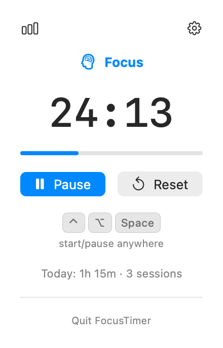
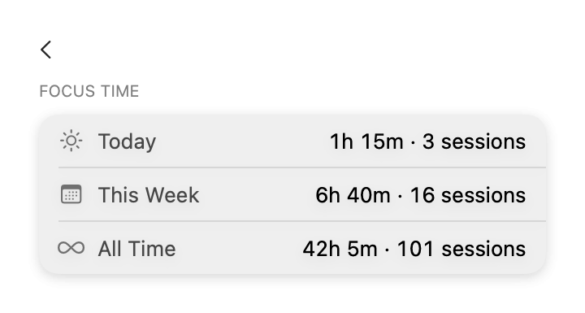

# FocusTimer

A lightweight Pomodoro-style focus timer that lives in the macOS menu bar.

## Download

[**Download FocusTimer.zip**](https://github.com/Kurbamit/FocusTimer/releases/download/v1.0.0/FocusTimer.zip) (latest: [v1.0.0](https://github.com/Kurbamit/FocusTimer/releases/tag/v1.0.0))

Unzip and drag `FocusTimer.app` to `/Applications`. On first launch, macOS will say **"Apple could not verify FocusTimer.app is free of malware"** — this happens because the app is signed with a personal Apple Developer certificate, not a paid Developer ID, so it isn't notarized by Apple. It's expected and the app is safe (you built it from this source yourself, or trust whoever sent it). Clear it with one Terminal command before opening:

```bash
xattr -cr /Applications/FocusTimer.app
```

Then open the app normally. (If you'd rather not use Terminal: open System Settings → Privacy & Security → scroll to the bottom → click **Open Anyway** next to the FocusTimer warning, then confirm.)

## Screenshots

| Timer | Stats |
| --- | --- |
|  |  |

## Features

- Menu bar item showing the remaining time (e.g. `24:13`) while running, and an idle icon otherwise
- Click to open a small popover with the time, progress bar, Start/Pause, and Reset
- Global keyboard shortcut (⌃⌥Space) to start/pause from anywhere, even when the popover is closed
- Fixed cycle: 25 min focus, 5 min short break, and a 15 min long break after every 4 focus sessions, each with its own accent color
- Duration changes in Settings apply immediately to the current (non-running) phase — no need to hit Reset
- Sound and system notification when a session ends
- Day / week / all-time focus statistics, viewable from the popover
- Settings window for customizing durations, cycle length, and alerts
- Optional "Launch at Login"
- No Dock icon — pure menu bar app

## Requirements

- macOS 26.5 or later
- Xcode 17 or later

## Building & running

```bash
open FocusTimer.xcodeproj
```

Build and run (`⌘R`) from Xcode. The app has no Dock icon or main window — look for its icon in the menu bar.

To build from the command line:

```bash
xcodebuild -project FocusTimer.xcodeproj -scheme FocusTimer -configuration Debug build
```

## Project structure

- `FocusTimer/FocusTimerApp.swift` — app entry point, `MenuBarExtra` + `Settings` scenes
- `FocusTimer/TimerViewModel.swift` — timer state machine (focus/break cycle, notifications, per-phase color/icon)
- `FocusTimer/AppSettings.swift` — user-configurable settings, persisted to `UserDefaults`
- `FocusTimer/FocusStatsStore.swift` — day/week/all-time focus statistics storage
- `FocusTimer/GlobalHotKeyManager.swift` — systemwide keyboard shortcut registration (Carbon hotkey API)
- `FocusTimer/ContentView.swift`, `TimerControlsView.swift`, `StatsView.swift`, `SettingsView.swift` — popover and settings UI
- `FocusTimer/KeyCapView.swift`, `StatRow.swift`, `ToggleRow.swift`, `StepperRow.swift`, `SettingsSection.swift` — shared UI components

See [`MVP.md`](MVP.md) for the original feature spec.
